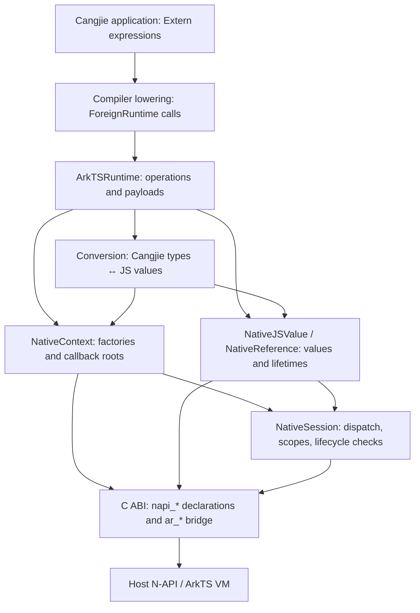
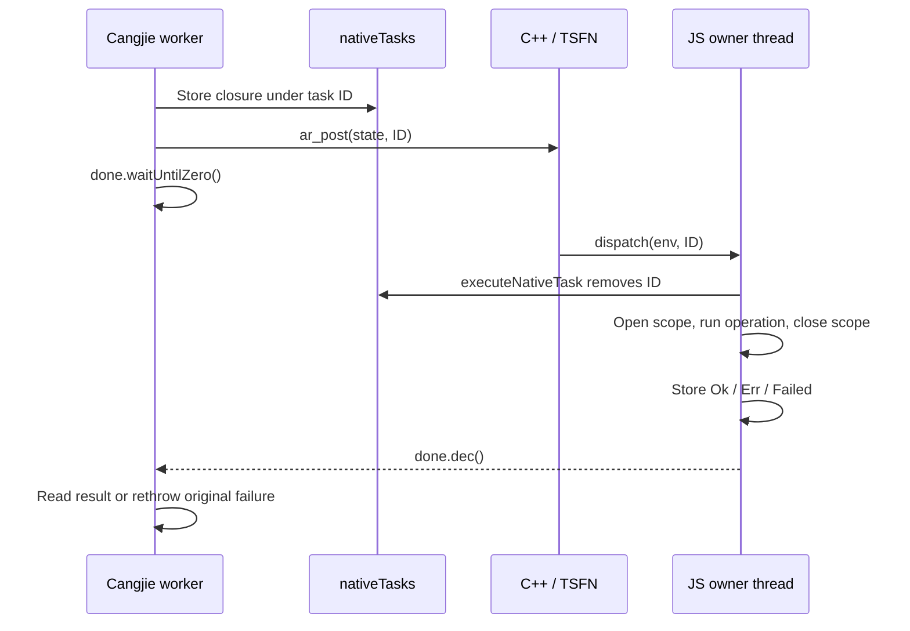
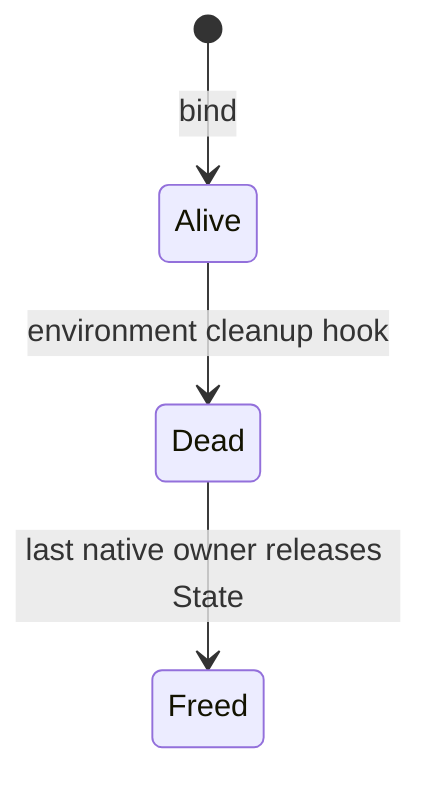

# `arkts_runtime` architecture

This document describes the current implementation.
Paths are relative to the repository root.

`arkts_runtime` lets Cangjie code access ArkTS values through `Extern<ArkTSRuntime>`.
It implements the compiler's `ForeignRuntime` contract.
It calls the host's public N-API C interface.

## 1. Layers and source map



These are responsibility boundaries.
They are not separate Cangjie packages.
The core files belong to `package arkts_runtime`.
The public runtime has one class declaration in `runtime.cj`.

| Layer | Source | Main responsibility |
| --- | --- | --- |
| Compiler contract | [hosttest](hosttest/) | Verify which runtime calls the compiler emits. |
| Public facade | [runtime.cj](arkts_runtime/src/runtime.cj) | Implement operations, binding, payloads, receivers and public helpers. |
| Type conversion | [conversion.cj](arkts_runtime/src/conversion.cj) | Map Cangjie types to JS types and back. |
| Context | [native_context.cj](arkts_runtime/src/native_context.cj) | Create values, functions, externals and modules. Hold callback roots. |
| Values | [native_values.cj](arkts_runtime/src/native_values.cj) | Wrap local values. Retain heap values. Execute property, index and call operations. Decode errors. |
| Session | [native_session.cj](arkts_runtime/src/native_session.cj) | Dispatch work. Open scopes. Return results across threads. |
| C declarations | [native_api.cj](arkts_runtime/src/native_api.cj) | Declare N-API calls, bridge calls, statuses and result layouts. Session bridge declarations also live in `native_session.cj`. |
| Native bridge | [backend.cpp](arkts_runtime/native/backend.cpp), [backend.h](arkts_runtime/native/backend.h) | Own native state, references, release queues, TSFN dispatch and callback adapters. Implement combined operations. |
| Library errors | [exceptions.cj](arkts_runtime/src/exceptions.cj) | Define binding exceptions and `ArkTSNativeException`. |
| Integration | [cjpm.toml](arkts_runtime/cjpm.toml), [build.sh](arkts_runtime/native/build.sh) | Build the static Cangjie library and shared native bridge. |

The core imports standard-library packages only.
Apps may still use `ohos.ark_interop` for registration or benchmark comparison.
That adapter is outside the core dependency boundary.

## 2. Compiler-facing operations

`Extern<T>` and `ForeignRuntime<T>` come from the Cangjie SDK.
The compiler lowers dynamic syntax to static runtime calls.

| Cangjie expression | Runtime operation |
| --- | --- |
| `value.field` | `memberAccess(value, "field")` |
| `value.field = x` | `memberUpdate(value, "field", x)` |
| `value[index]` | `indexedAccess(value, index)` |
| `value[index] = x` | `indexedUpdate(value, index, x)` |
| `value(args...)` | `functionCall(value, arguments)` |
| Conversion into `Extern` | `toExtern<R>(value)` |
| Conversion out of `Extern` | `fromExtern<R>(value)` |

Arguments are evaluated before the runtime call.
Assignments and calls convert their arguments inside the runtime.
The payload does not contain a deferred expression tree.

For example:

```cangjie
let result = ArkTSRuntime.fromExtern<Float64>(root.a.b.c.d)
```

The operation sequence is equivalent to:

```cangjie
let a = ArkTSRuntime.memberAccess(root, "a")
let b = ArkTSRuntime.memberAccess(a, "b")
let c = ArkTSRuntime.memberAccess(b, "c")
let d = ArkTSRuntime.memberAccess(c, "d")
let result = ArkTSRuntime.fromExtern<Float64>(d)
```

Each member access completes independently.
Each opens its own runtime scope.
Intermediate objects must survive scope closure.

Operator lowering also follows the compiler contract.
Do not implement property compound assignment as an atomic update.
Check [compiler_contract_test.cj](hosttest/compiler_contract_test.cj) before changing operation boundaries.

## 3. Binding and context creation

Public binding API:

```cangjie
public static func bind(env: CPointer<Unit>): Unit
```

`env` is a borrowed `napi_env`.
It is not an internal `ARKTS_Env` or a `JSContext` pointer.
Call `bind` on the environment's JS thread.
The host must initialize the Cangjie runtime first.

```text
ArkTSRuntime.bind(env)
  └─ contextMutex
      └─ NativeContext(env)
          └─ NativeSession(env)
              └─ ar_bind(env, executeNativeTask)
                  ├─ capture native thread identity
                  ├─ create thread-safe function
                  ├─ register environment cleanup hook
                  └─ unref dispatcher so it does not keep the event loop alive
```

Binding associates the runtime with one host environment.
The first successful call establishes this association permanently.
The table below describes initialization failures, repeated calls, and environment teardown.

| Binding rule | Behavior |
| --- | --- |
| Null pointer on initial bind | `IllegalArgumentException`. |
| Operation needs a context before binding | `ArkTSContextNotBoundException`. |
| First successful bind | Store one `NativeContext` in `context_`. |
| Later bind | `ArkTSContextAlreadyBoundException`, including the same environment. |
| Environment destroyed | Keep the binding. Reject later VM operations. |

`contextMutex` serializes binding attempts.
There is no public unbind or rebind operation.
The cached `undefined_` pair is created on first use.
`isBound()` can be queried before binding.
Identity conversions can return an existing `Extern` without entering the context.

The [test app's registration adapter](arkts_runtime/testapp/entry/src/main/cangjie/index.cj)
shows how to pass the environment explicitly:

```cangjie
// Inside a JSModule registration callback. `context` is the adapter's JSContext.
if (!ArkTSRuntime.isBound()) {
    ArkTSRuntime.bind(context.getNapiEnv())
}
```

`getNapiEnv()` requires the matching SDK/platform API.

## 4. Values, payloads and ownership

There are three distinct representations.

| Representation | Contents | Lifetime |
| --- | --- | --- |
| `NativeJSValue` | Session, local N-API handle, kind, copied number and boolean. | Heap handles are local to a live scope. Immediate payloads are scope-independent. |
| `NativeReference` | Session, owned bridge reference and known kind. | Keeps a heap value alive across scopes and Cangjie calls. |
| `Extern<ArkTSRuntime>` | An `ArkTSHandle` stored as `Any`. | Carries copied immediates or retained references. |

`NativeJSValue` is an immutable struct containing a JS handle and its metadata.
Using a struct avoids a separate Cangjie wrapper allocation for each value.
Referenced JS objects remain in the ArkTS VM.

`ar_decode_value` reads the type and primitive payload in one native call.
Factories skip decoding when the result type is already known.

An `Extern<ArkTSRuntime>` stores the runtime's representation of a JS value in its `Any` payload.
The runtime uses the `ArkTSHandle` enum for this payload.
It carries either a copied immediate value, a retained reference, or a function with its receiver:

```cangjie
private enum ArkTSHandle {
    | Imm(NativeJSValue)
    | Ref(NativeReference)
    | Method(NativeReference, ArkTSHandle)
}
```

| Handle | JS kinds | Meaning |
| --- | --- | --- |
| `Imm` | Undefined, null, boolean, number. | Copy the value's payload. |
| `Ref` | String, bigint, symbol, object, function, external. | Own a strong reference. Arrays are objects. |
| `Method` | Function read through a member or index. | Own the function and retain its receiver handle. |

`retain` wraps a local value in an `Extern`, preserving it beyond the current N-API scope.
`jsValueOf` recovers a local value for the current scope.
Its helper `evalPayload` rejects non-`ArkTSHandle` payloads with `ExternConversionException`.

### Local handles

The `local` field of `NativeJSValue` holds a `napi_value`: an opaque JS handle valid only within its N-API scope.
`NativeJSValue.raw` supplies the handle used by C-API calls:

- For `Imm` values, it creates a handle in the current scope from the copied payload.
- For heap values, it returns `local`. When recovering a `Ref` or `Method`, `jsValueOf` resolves the retained reference into a local handle for the current scope.

This is why an `Imm` can survive scope closure, while a heap `NativeJSValue` cannot.
Use `retain` to preserve a heap value across scopes.
The consuming N-API operation validates the environment; returning `local` does not repeat those checks.

### Strong references and release

For heap values, `retain` creates a `NativeReference` backed by a strong N-API reference (`napi_ref`).
It keeps the JS value alive across scopes until the Cangjie wrapper is collected.
Releasing it requires coordination with the JS thread:

```text
Extern.Ref
  └─ NativeReference                  Cangjie-owned wrapper
      ├─ NativeSession ── State       Keeps native bookkeeping alive
      └─ Reference ── napi_ref        Keeps the JS value alive
```

The bridge first tries a direct strong `napi_ref`.
If N-API rejects a primitive heap value, it uses a private array box.
Slot `0` is an own data property, so inherited setters cannot intercept it.

A Cangjie destructor may run off the JS thread.
`ar_release_reference` therefore queues deletion.
It does not call `napi_delete_reference` there.

The JS thread drains the queue during dispatch or scope entry.
After teardown, late release frees native bookkeeping without entering the dead VM.

### Method receivers

```cangjie
let method = object.update
method(2.0)
```

`memberAccess` retains the function as `Method(function, receiver)`.
`calleeOf` recovers both values.
`functionCall` passes the receiver as `thisArg`.
Extracted methods keep their receiver under this library's contract.
A function obtained without a member/index receiver uses JS `undefined` as `this`.

## 5. Type conversion

The conversion interfaces are internal:

```cangjie
interface ToJS {
    func toJS(): NativeJSValue
}

interface FromJS<T> {
    static func fromJS(value: NativeJSValue): T
}
```

| Cangjie value | JS representation | Reading back |
| --- | --- | --- |
| `Unit` | Undefined. | `Unit.fromJS` ignores the input. |
| `Bool` | Boolean. | Require boolean. |
| `Int8/16/32`, `UInt8/16/32` | Number. | Require a finite integral value in range. |
| `Float16/32/64` | Number. | Require number; narrow to the requested float type. |
| `Int64`, `UInt64`, `BigInt` | Bigint. | Require bigint. Fixed-width targets also check range. |
| `String` | String. | Require string; copy UTF-8 data. |
| `Some(x)` | Converted `x`. | Convert the present value recursively. |
| `None<T>` | Undefined. | Undefined and null both become `None`. |
| `Array<T>` | Array. | Convert each element recursively. |
| `Extern<ArkTSRuntime>` | Its held JS value. | Preserve the JS value; public identity paths can return the existing `Extern`. |

Use `1.0` for a JS number.
An inferred Cangjie `Int64`, such as `1`, maps to bigint.
Numeric readers do not perform JS-style string or boolean coercion.

`toJSValue(Any)` dispatches through `ToJS`, with a separate `Extern` branch.
`fromJSValue<R>` handles common concrete types directly.
Generic array/option readers use `TypeTag<R>` and `JSReader`.
This reaches `FromJS<R>` when `R` is otherwise unconstrained.

Unsupported types throw `ExternConversionException`.
An unsupported array element type fails when that element is converted.

### Numeric arrays

`Array<Float64>` has a dedicated native path.
Nested arrays reach it recursively for each numeric row.

| Direction | Implementation rule |
| --- | --- |
| Cangjie → JS | Clone the source before JS setters can reenter. Pin the copy. Materialize and insert numbers in C++. |
| JS → Cangjie | Allocate and pin the output. Read each element in C++. Check the current length before each read. |
| Getter shrinks array | Fail at the same out-of-range index as the generic reader. |
| Non-number element | Reuse the generic `Float64.fromJS` conversion error. |
| Getter throws | Stop and translate the pending JS exception. |

Every `acquireArrayRawData` must have a `releaseArrayRawData` in `finally`.
Native array loops can invoke JS and Cangjie callbacks.
They use ordinary FFI.

## 6. Threading, scopes and dispatch

Cangjie callers may run on different threads, but N-API operations must execute on the JS environment's owner thread.
`NativeSession.run` bridges this boundary: it executes inline on the owner or posts the operation there and waits for its result.
Each operation runs inside an N-API scope, which bounds the lifetime of its local handles.

`ar_bind` records the owner as a native OS thread identity, not a Cangjie task ID.

On the owner thread, `run` calls `newScope(operation)` directly.
Reentrant calls from JS callbacks follow the same path, opening nested scopes without queuing or waiting.

On another thread, `run` registers a Cangjie closure and posts its ID through the session's N-API thread-safe function (TSFN).
The JS event loop dispatches it on the owner thread, where it executes inside `newScope`.
The caller waits for completion, then receives the result or rethrows the captured exception or error.
If the environment shuts down before execution, cancellation wakes the caller with a `ForeignRuntimeException`.

`fromExtern` bypasses dispatch when conversion needs only a copied immediate payload.
Off-thread conversion requires a reader recognized by `isCopiedScalarReader<R>` and a live environment.
Conversions that may access the VM still use `run`.



`nativeTasks` holds managed closures in Cangjie memory.
C++ receives only integer IDs and a static C callback.
`taskMutex` protects registry insertion and removal.
Posting failure removes the registry entry.
Task ID `0` is reserved for release-queue wakeups.

`SyncCounter(1)` publishes each synchronous call's result.
The callback stores the result before decrementing the counter.
The caller reads it only after `waitUntilZero` returns.
The counter provides the required happens-before ordering.

`newScope` always closes its scope in `finally`.
`AR_SCOPE_NEEDS_DRAIN` means the scope opened successfully but releases are pending.
Drain them through ordinary FFI, then execute the operation.

**Do not block the JS thread waiting for a worker that needs `run`.**
The worker is already waiting for that JS thread.

## 7. Native state and teardown

Each `NativeSession` uses a C++ `State` record created by `ar_bind`.
It coordinates thread dispatch, environment access and deferred reference release.
It borrows the JS environment; it does not own the VM.

The environment can shut down while Cangjie values or queued calls still exist.
For example, terminating a Worker can leave a caller waiting for dispatch and retained values awaiting collection.
`State` must therefore survive teardown long enough to reject late access, cancel waiting calls and release native bookkeeping safely.

`State` in `backend.cpp` groups the environment, dispatcher and lifecycle bookkeeping:

| Field | Purpose |
| --- | --- |
| `env` | Borrowed N-API environment. |
| `dispatcher` | Per-session N-API thread-safe function, or TSFN. |
| `owner` | Native thread identity. |
| `callback` | Static Cangjie task-entry function. |
| `alive` | Atomic environment-liveness flag. |
| `owners` | Reference count keeping the `State` record allocated. |
| `mutex` | Protect posting/cleanup and the release list. |
| `releases`, `needsDrain` | Deferred reference deletions and their fast-path flag. |

`alive` tracks whether the JS environment can still be used.
`owners` independently tracks whether the native record can be freed.
The session, dispatcher and each retained-reference record increment this count.
They decrement it on session destruction, TSFN finalization and reference deletion, respectively.

Keeping `State` allocated does not keep the environment alive.
Shutdown marks it dead; the last owner later frees it:



This native reference count does not root Cangjie objects.
The bound context keeps its session reachable.
Internal callers must also keep their session reachable until queued work completes.

During normal operation, `NativeSession.env` uses `ar_access_status` to check this state before returning the environment.
Status `0` permits access; `1` (dead) and `2` (wrong thread) become `ForeignRuntimeException`.

At shutdown, the host invokes the cleanup hook registered by `ar_bind` on the environment's thread:

1. Mark `alive = false` under the native mutex.
2. Drain pending reference deletions while the environment is still available.
3. Abort the TSFN.
4. Deliver cancellation to pending tasks as the dispatcher is torn down.
5. Keep the dead state record until its remaining owners release it.

The dead record is a tombstone.
It lets late calls reject the environment without dereferencing destroyed VM state.
Late reference destruction frees native bookkeeping without calling into the destroyed VM.

Aborting the TSFN also completes queued calls that can no longer execute.
The dispatch callback reports cancellation to `executeNativeTask`, which stores a failure and decrements the waiting call's completion counter.
This wakes the caller instead of leaving it blocked indefinitely.
No exception may escape this C callback boundary.

## 8. Callbacks and external objects

Callbacks reverse the usual call direction: JS invokes a function implemented in Cangjie.
The JS function must keep the Cangjie closure and its captures alive for later calls.
The bridge stores them in a managed registry and passes only an ID and C-callable entry points to C++.

`ArkTSRuntime.function` exposes a Cangjie closure as an ArkTS function.
Its public body receives `Array<Extern<ArkTSRuntime>>`.
It does not receive a `this` argument.

```cangjie
let increment = ArkTSRuntime.function { args =>
    let number = ArkTSRuntime.fromExtern<Float64>(args[0])
    ArkTSRuntime.toExtern(number + 1.0)
}
let answer = ArkTSRuntime.fromExtern<Float64>(increment(41.0))
```

Creating the function roots its closure and context in `nativeFunctions`.
The JS function's native `FunctionData` record connects invocation and finalization to that registry entry:

```text
nativeFunctions[id] = (NativeContext, Cangjie closure)
        ↑ strong managed root
        │
JS function → FunctionData{id, call, drop}
        │ invoke → nativeFunctionCall → convert arguments → Cangjie body
        └ finalizer → nativeFunctionDrop → remove managed root
```

`functionMutex` protects the function and external registries.
It is released before user code runs, so callbacks can reenter the library without holding the registry lock.
JS finalization removes the root, allowing the closure and its captures to be collected when otherwise unreachable.
Creation failure removes the root immediately.

Invocation also crosses an exception boundary.
Cangjie `Exception` and `Error` become a JS `Error` through `napi_throw_error`.
The native callback returns without letting Cangjie exceptions cross C frames.

External objects carry a Cangjie object through JS as opaque data, rather than exposing its fields or methods.
They follow the same ID/root pattern: `nativeExternals` retains the object until JS finalization calls `nativeExternalDrop`.
Creation is internal, through `NativeContext.external`.
Public `toExtern` does not automatically wrap arbitrary Cangjie objects.

An external supplied by another native module may contain unrelated data.
C++ tracks its own `ExternalData` pointers in a guarded set.
`ar_external_id` validates membership before reading an ID.

## 9. Property, index and module semantics

`memberAccess` and `indexedAccess` both read JS properties, but choose different native paths based on the key's Cangjie type.
In particular, an `Int64` index uses checked array access; a `Float64` index uses JS property-key access.
The corresponding update operations follow the same distinction.
The rules below define these observable behaviors and the native helpers that implement them.

| Operation | Implementation detail |
| --- | --- |
| String member name | `ar_get_property_utf8` / `ar_set_property_utf8` combine key creation and access. |
| Embedded NUL name | Use an explicit-length N-API string instead of a terminated name. |
| Numeric property key | `ar_get_number_property` creates the key and reads inside one native call. |
| Missing property | Return JS undefined. |
| Primitive member receiver | Reject with `ExternMemberAccessException`. There is no automatic boxing. |
| `Int64` index | Array element access with array/type/bounds rules. |
| `Float64`, `String`, `Utf16String` index | Property-key access. |
| `Extern` index | Accept number, string or symbol only. |
| Integer-index write | May grow the array. Negative indices fail. Values above `UInt32.Max` overflow. |
| Write at `UInt32.Max` | Preserve the legacy behavior that resets array length to zero. |
| `objectKeys` | Call JS `Object.keys` through N-API. |
| `objectDefineOwnProperty` | Call JS `Object.defineProperty` through N-API. |

The JS built-ins preserve behavior seen on the validated targets.
N-API enumeration filters and property-definition statuses alone were insufficient.
See [native backend notes](arkts_runtime/native/README.md).

Value strings and property keys use explicit UTF-8 lengths.
`Utf16String` can hold copied UTF-16 code units for keys, including unpaired surrogates.
Its native input buffer has a terminator even when an explicit length is supplied.
Some target implementations inspect that terminator.

Short-string decoding uses a bounded buffer for at most 128 UTF-16 units.
Three UTF-8 bytes per code unit, plus a terminator, bound its capacity.
Long strings use a size query and exact allocation.

BigInt conversion uses sign and magnitude bytes.
The bridge converts big-endian bytes to little-endian 64-bit N-API words and back.
It does not call a JS BigInt constructor.

Module loading uses the bound environment, but also depends on the host's module loader and execution context:

| Module helper | Native path | Constraint |
| --- | --- | --- |
| `requireArkModule` | `napi_load_module`. | ArkTS module context must be on the stack. Posted worker calls can lack it. Bundle runtime-only sources as required. |
| `requireSystemNativeModule` | Call host `requireNapi(name, false, prefix)`. | Uses the host's system-module loader. |

Binding the environment does not create module-resolution context.

## 10. Error boundaries

N-API reports failures through status codes and pending JS exceptions.
The native wrappers turn these into Cangjie exceptions; `ArkTSRuntime` then maps them to the public operation's error category.
The translation follows this path:

```text
N-API status / pending JS exception
  → nativeCheck
  → ArkTSNativeException or ForeignRuntimeException
  → memberError / indexError / translatingJSExceptions
  → public operation error
```

`nativeCheck` normally returns immediately for status `0`.
For JS-executing operations, pass `checkPending: true`.
An operation can leave a JS exception pending despite a success status.

On a JS failure, `nativeCheck`:

1. Retrieves and clears the pending exception.
2. Converts its message to text.
3. Reads a stack when available.
4. Clears failures from a custom stack getter.
5. Throws `ArkTSNativeException(34300002, detail)`.

`translatingJSExceptions` converts that code to `ForeignRuntimeException`.
Other error categories keep their dedicated paths.

| Failure | Public result |
| --- | --- |
| Binding state | `ArkTSContextNotBoundException` / `ArkTSContextAlreadyBoundException`. |
| JS throw | `ForeignRuntimeException`. |
| Member receiver mismatch | `ExternMemberAccessException`. |
| Index receiver mismatch or bounds error | `ExternIndexedAccessException`. |
| Integer-index write above `UInt32.Max` | `OverflowException`. |
| Non-callable callee | `ExternFunctionAccessException`. |
| Conversion failure or foreign payload | `ExternConversionException`. |
| Other native category, such as missing module | `ArkTSNativeException`; inspect `code`. |
| Unclassified N-API status or dead session | `ForeignRuntimeException`. |

Important native category codes are `34300001` for bounds, `34300002` for JS throws,
`34300005` for type mismatch, and `34300006` for a missing module.
These are library error codes, not N-API status values.

## 11. C ABI and performance rules

Cangjie declarations must match the native functions' parameter types, result layouts and calling conventions.
This C ABI is also where the library chooses how much work to perform per native call.
Simple operations call N-API directly; bridge helpers manage native state or combine several operations:

```text
Cangjie → napi_*                         direct public C-API operation
Cangjie → ar_* → one or more napi_*       bridge operation
```

`NativeEnv` and `NapiValue` are opaque `CPointer<Unit>` aliases.
Do not inspect VM layouts or cast between N-API values and private `ARKTS_*` values.

The bridge owns its result layout:

```cpp
typedef struct {
    double scalar;
    int32_t kind;
    int32_t status;
} ar_value_info;
```

`NativeValueInfo` in `native_api.cj` matches this 16-byte C structure.
It describes decoded data, not the VM's internal representation.
Change both declarations together.
Do not pass C++ containers or Cangjie managed objects through this ABI.

| Bridge status | Meaning |
| --- | --- |
| `0` | N-API success. |
| Positive status | N-API failure/status category. |
| `AR_INDEX_OUT_OF_RANGE = -1` | Checked array index is outside the current bounds. |
| `AR_SCOPE_NEEDS_DRAIN = -2` | Scope opened; run ordinary-FFI release draining. |
| `AR_BOXED_REFERENCE = -3` | Resolve through the ordinary-FFI boxed-reference helper. |

`@FastNative` is an audited execution choice.
It is not a general speed switch.

| Fast FFI | Ordinary FFI |
| --- | --- |
| Fixed-size type/payload reads and validation. | Property access and function calls. |
| Scope open/close and direct reference operations. | Compatibility boxing and release-queue draining. |
| Queuing disposal and nonblocking task posting. | Module loading and callback/function creation. |
| Bounded short-string copying. | Long-string copying and array loops that can run accessors. |

Keep fast paths short and callback-free.
Split slow or reentrant work into a separate ordinary call.
Preserve pending-exception checks after JS execution.
Measure individual cases; an aggregate can hide a regression.
See [performance validation](arkts_runtime/native/performance.md).

## 12. Build and host integration

The library has two build artifacts: a static Cangjie library and a shared C++ bridge.
The consuming application must link and package both with compatible runtime libraries.
At startup, the host initializes Cangjie and supplies a live `napi_env` for binding.
The build produces:

```text
src/*.cj ── cjpm/cjc ── libarkts_runtime.a + Cangjie metadata
native/backend.cpp ── NDK clang++ ── libarkts_runtime_native.so
application + both artifacts + SDK runtime libraries ── HAP
```

The supplied native build targets `aarch64-linux-ohos`.
It links `libace_napi.z` and copies the NDK `libc++_shared.so`.
The library's release profile uses `-O2` with IEEE floating-point behavior.

App integration points:

| File | Responsibility |
| --- | --- |
| App `entry/cjpm.toml` | Depend on `arkts_runtime`; link `-lace_napi.z` and `-larkts_runtime_native`. |
| App `entry/hvigorfile.ts` | Copy runtime libraries, build the bridge, set `ARKTS_RUNTIME_NATIVE_LIB`. |
| App registration callback | Initialize/bind using the live host environment. |
| [dependencies_libs](dependencies_libs/) | Supply compatible Cangjie runtime, standard libraries and app-specific libraries. |

Ship one compatible Cangjie runtime and one `std-core`.
Duplicate standard libraries can break runtime type identity.
See [integration instructions](arkts_runtime/README.md).

The [standalone consumer](arkts_runtime/standalone/README.md) proves the independent path:

```text
Regular N-API addon receives napi_env
  → InitCJRuntime
  → LoadCJLibraryWithInit
  → FindCJSymbol
  → Cangjie export calls ArkTSRuntime.bind(env)
```

It does not use `JSContext`, `JSModule`, or a competing interop callback table.
Its Worker probe uses a separate internal session to test teardown.
It does not rebind the public runtime.

## 13. Making changes

Changes often cross the runtime, value wrappers and native bridge.
Use the table below to locate the implementation, identify the contracts it must preserve and choose validation.
The device-step numbers refer to test groups, not this document's sections.

| Change | Edit first | Preserve | Validate |
| --- | --- | --- | --- |
| Add or change dynamic syntax behavior | `runtime.cj`; compiler contract tests. | Evaluation order, receiver retention, public error categories. | Host contract; device steps 5 and 9. |
| Add a converted type | `conversion.cj`; dispatch in `runtime.cj` when needed. | Strict type/range checks and recursive container behavior. | Device step 6, including invalid values. |
| Add an immediate fast path | `NativeJSValue`, `retain`, `fromExtern`. | Copy every needed field. Off-thread readers must not enter the VM. | Closed scopes, GC, dead environments and blocked-JS-thread tests. |
| Add a C-API operation | `native_api.cj` or session declarations; `native_values.cj` / `native_context.cj`. | Scope, owner/liveness validation, statuses, pending exceptions. | Relevant device group and reentrant callbacks. |
| Add/change an `ar_*` helper | `backend.h`, `backend.cpp`, Cangjie declaration. | Exact parameter/result ABI and ownership on failure. | Native build, independent consumer, device suite. |
| Change retained values | `NativeReference`, `Reference`, `drain`. | Deferred JS-thread deletion and state ownership counts. | Device step 4 and Worker late-release probe. |
| Change dispatch | `NativeSession`, `State`, `dispatch`, `cleanup`. | Publish result before wakeup; complete cancellation; catch both `Exception` and `Error`. | Nested calls, concurrent callers, rethrows and Worker termination. |
| Change callbacks | Registry functions and native `FunctionData` / `ExternalData`. | Root captures until finalization; release locks before user code. | Device steps 10 and 12; callback lifetime and GC. |
| Optimize conversion or access | Relevant Cangjie wrapper and native helper. | NUL/UTF-16 keys, numeric boundaries, accessor side effects. | Debug and release tests; paired benchmark cases. |

A typical internal call pattern is:

```cangjie
// Inside a valid JS scope. Adapt the operation and arguments as needed.
var result = NapiValue()
let status = unsafe { napi_get_property(session.env, raw, key.raw, inout result) }
nativeCheck(session, status, checkPending: true)
NativeJSValue(session, result)
```

Before returning a heap value through a public operation, retain it.
Before exposing a callback to C, add failure containment and root cleanup.
Before adding `@FastNative`, inspect the complete native call path.

## 14. Validation map

Validation covers compiler lowering, execution in the ArkTS VM, application integration and performance.
Host tests verify the compiler contract; device tests exercise the runtime's value, thread and lifetime behavior.
The standalone consumer checks integration without `ohos.ark_interop`, while demos and paired benchmarks check application behavior and cost.
The table maps each layer to its test entry points:

| Layer | Location | What it proves |
| --- | --- | --- |
| Compiler | [hosttest](hosttest/) | Lowering, argument order and conversion boundaries. No ArkTS VM. |
| Runtime | [src/tests](arkts_runtime/src/tests/), [Hypium suite](arkts_runtime/testapp/entry/src/ohosTest/ets/test/ArkTSRuntime.test.ets) | Values, scopes, GC, exceptions, concurrency and JS-visible behavior. |
| Independent integration | [standalone](arkts_runtime/standalone/) | Core dependency independence, binding, Worker teardown and cancellation. |
| Application | [demos](demos/), [smoke.py](demos/smoke.py) | Public API use and visible UI behavior. |
| Performance | [benchmarks](demos/benchmarks/), [compare_backends.py](demos/benchmarks/compare_backends.py) | Per-case cost, retained heap growth and paired old/new measurements. |

Device scenarios are compiled only for the test app's bundle.
Every new top-level test declaration needs:

```cangjie
@When[bundle == "com.example.testArkTSForeignRuntime"]
```

Register scenarios in their group and update the ArkTS suite's expected name list.
The adapter passes JS-owned fixtures through a global fixture array and `runNativeScenario`.
It does not reinterpret private SDK JS values as N-API values.

Run from the repository root:

```sh
./hosttest/run.sh
./arkts_runtime/devicetest.sh --all
BUILD_MODE=release ./arkts_runtime/devicetest.sh --all

sh arkts_runtime/standalone/run.sh
DEVICE=127.0.0.1:5555 sh arkts_runtime/standalone/run.sh

./demo.sh demos/hello
python3 demos/smoke.py 0123456789ABCDEF hello
./demo.sh demos/rectangle
python3 demos/smoke.py 0123456789ABCDEF rectangle

python3 demos/benchmarks/compare_backends.py --baseline cbdc32f --all
./demos/benchmarks/run.sh --all
```

Use the connected device's ID in place of the examples.
Standalone and paired comparisons reuse the benchmark app identity.
The last command restores the standard benchmark app.

## Glossary

### Runtime and values

| Term | Meaning in this library |
| --- | --- |
| ArkTS / JS | The host language and JavaScript value semantics exposed through N-API. |
| VM | Virtual machine that executes ArkTS/JS and manages its values. |
| Host | Application or runtime that supplies the JS environment and loads the library. |
| SDK | Software development kit supplying the compiler, runtime libraries and platform APIs. |
| Compiler lowering | Translation of `Extern` expressions into `ForeignRuntime` method calls. |
| `ForeignRuntime<T>` | SDK contract for dynamic member access, indexing, calls and conversion. |
| `Extern<ArkTSRuntime>` | SDK value carrying this runtime's representation of a JS value. |
| `ArkTSRuntime` | Public implementation of the compiler contract and library helpers. |
| Binding | Permanent association of the public runtime with one JS environment. |
| `NativeContext` | Internal value factories and access to a `NativeSession`. |
| `NativeSession` | Internal coordinator for environment access, dispatch and scopes. |
| Payload | Runtime data stored in an `Extern` as `Any`; here, an `ArkTSHandle`. |
| `ArkTSHandle` | Payload enum with `Imm`, `Ref` and `Method` variants. |
| `Imm` / immediate | Undefined, null, boolean or number represented by copied data. |
| Heap value | Value requiring a retained reference to survive scope closure, including strings, objects and functions. |
| `Ref` | Payload variant holding a `NativeReference`. |
| `Method` | Payload variant holding a retained function and its receiver. |
| Receiver / `thisArg` | Value supplied as JS `this` when calling a function. |
| `NativeJSValue` | Struct holding a session, local handle, type and copied scalar data. |
| `kind` / `JSType` | Cached integer type tag and the constants defining its mapping. |
| Scalar | Single value rather than a container; copied scalar reads can avoid VM access. |
| `raw` | `NativeJSValue` getter supplying the N-API handle for a C-API call. |
| `retain` | Wrap a local value in an `Extern` that survives the current scope. |
| `jsValueOf` / `evalPayload` | Recover a local value from an `Extern` / validate and resolve its payload. |
| `calleeOf` | Recover a function and its optional receiver for invocation. |
| `ToJS` / `FromJS<T>` | Internal conversion contracts for Cangjie values and JS values. |
| `TypeTag<T>` / `JSReader` | Internal adapters selecting a generic type's JS reader. |
| Identity conversion | Return an existing `Extern` without changing its represented value. |
| Coercion | Implicit JS-style type conversion; numeric readers instead require the expected type. |
| Boxing | Store a value in a private JS container when direct retention is unsupported. |
| External object | JS external value carrying an ID for a rooted Cangjie object. |

### Handles and memory

| Term | Meaning in this library |
| --- | --- |
| N-API | Host's public C interface for JS values, calls and lifecycle operations. |
| `napi_env` / `NativeEnv` | Host environment handle / its Cangjie pointer alias. |
| `JSContext` / `JSModule` | `ohos.ark_interop` adapter types; the core does not depend on them. |
| `ARKTS_*` | Private engine API types; they are not interchangeable with N-API handles. |
| Opaque handle | Reference used through API operations without inspecting its representation. |
| Local handle / `napi_value` / `NapiValue` | Scope-limited JS value handle / its Cangjie pointer alias. |
| Scope | N-API lifetime boundary for local handles. |
| `newScope` | Open a scope, run an operation and close the scope in `finally`. |
| Strong reference / `napi_ref` | Retained reference preventing collection of a JS value until released. |
| `NativeReference` | Cangjie owner of a native retained-reference record. |
| `Reference` | C++ record holding a `napi_ref` and an ownership share in `State`. |
| Borrowed | Usable under the host's lifetime rules; the library must not destroy it. |
| Ownership share | Native reference-count contribution that keeps `State` allocated. |
| GC | Garbage collection of unreachable managed objects. |
| Managed root | Reachable registry entry keeping a Cangjie object or closure alive. |
| Closure / capture | Function together with the values it retains from its surrounding code. |
| Destructor / finalizer | Cleanup invoked when a Cangjie wrapper / JS object or native resource is released. |
| Release queue / drain | Deferred reference deletions / processing those deletions on the JS thread. |
| Pinning | Keep managed array storage at a stable address while native code uses it. |
| Teardown / cleanup hook | Environment shutdown / host callback notifying the bridge of shutdown. |
| Tombstone | Dead `State` record retained so late access can fail safely. |

### Threads and callbacks

| Term | Meaning in this library |
| --- | --- |
| Owner thread | Native OS thread captured at binding; executes environment operations. |
| Worker / Cangjie task | Another execution thread / scheduled Cangjie unit of work; task identity is not native thread identity. |
| Event loop | Host mechanism that schedules JS work and posted callbacks. |
| Dispatch / dispatcher | Transfer work to the owner thread / the session's TSFN performing that transfer. |
| TSFN | N-API thread-safe function used to post work from other threads. |
| `run` / `post` | Execute on the owner and return its result / enqueue a closure for dispatch. |
| `nativeTasks` / task ID | Cangjie closure registry / integer passed through C++ to identify an entry. |
| `State` | C++ session record coordinating environment access, dispatch and reference release. |
| Callback / reentrancy | Call back into Cangjie from native or JS code / entry into the runtime while an earlier call is still active. |
| Mutex / atomic | Lock protecting shared operations / variable accessed with thread-safe atomic operations. |
| `SyncCounter` | Completion counter used to publish a dispatched result and wake its caller. |
| Happens-before | Ordering guarantee making the completed result visible before the waiting caller reads it. |
| Cancellation | Completion of queued work with failure when its environment shuts down. |
| Deadlock | Circular waiting; here, the JS thread waiting on a worker that needs JS dispatch. |
| `nativeFunctions` / `nativeExternals` | Managed registries rooting callback closures / external Cangjie objects by ID. |
| `FunctionData` / `ExternalData` | Native records connecting JS functions / externals to their managed registry entries. |

### Native interface, data and tooling

| Term | Meaning in this library |
| --- | --- |
| C-API | Functions and data types callable through the C interface. |
| ABI | Binary contract for parameter passing, result layout and calling conventions. |
| Native bridge / `ar_*` | C++ support layer / its exported C functions. |
| FFI | Foreign function interface used to call native functions from Cangjie. |
| `@FastNative` | Restricted FFI path for audited, short operations that cannot call back into managed code. |
| Ordinary FFI | Native-call path used for operations that may execute callbacks or longer work. |
| `@C` | Cangjie annotation exposing a C-callable entry point. |
| Status / pending exception | Native result code / JS exception awaiting retrieval and clearing. Both require checking. |
| `nativeCheck` | Translate native statuses and pending JS exceptions into Cangjie failures. |
| `ArkTSNativeException` | Library exception carrying a native error category code and detail. |
| `ForeignRuntimeException` | Public failure for JS throws, invalid environment access and unclassified native errors. |
| `AR_SCOPE_NEEDS_DRAIN` | Scope opened, but deferred reference releases need ordinary-FFI processing. |
| `AR_BOXED_REFERENCE` | Reference resolution must use the ordinary-FFI boxed-value helper. |
| `AR_INDEX_OUT_OF_RANGE` | Checked array access failed its bounds check. |
| `ar_value_info` / `NativeValueInfo` | Matching C and Cangjie layouts for decoded type, scalar and status. |
| Property key / accessor | Name, number or symbol identifying a JS property / getter or setter that may execute code. |
| Own property | Property defined directly on an object rather than inherited from its prototype. |
| UTF-8 / UTF-16 | Text encodings used for strings and property keys. |
| Code unit / surrogate | One encoded text unit / UTF-16 unit used in pairs for supplementary characters; keys may contain unpaired units. |
| NUL / terminator | Zero byte or code unit / marker ending a string buffer. Explicit lengths preserve embedded NULs. |
| `Utf16String` | Library wrapper preserving UTF-16 code units for property keys. |
| BigInt / sign and magnitude | Arbitrary-precision integer / representation separating its sign from its absolute-value bytes. |
| Big-endian / little-endian | Most-significant-first / least-significant-first ordering. |
| IEEE floating point | Number behavior preserving cases such as signed zero, infinity and NaN. |
| Module-resolution context | Host execution context needed to locate and load an ArkTS module. |
| NDK | Native development kit supplying the target C/C++ compiler and libraries. |
| `cjpm` / `cjc` / Hvigor | Cangjie package manager / compiler / application build system. |
| Static library / shared library | Code linked into a consumer / library loaded at runtime (`.a` / `.so`). |
| HAP / bundle | OpenHarmony application package / application identity used by build configuration. |
| N-API addon / standalone consumer | Native module loaded by the host / consumer validating integration without `ohos.ark_interop`. |
| Hypium / fixture / smoke test | Device test framework / supplied test data / basic application behavior check. |
| Paired benchmark / regression | Old and new implementations measured together / a performance or behavior degradation. |
